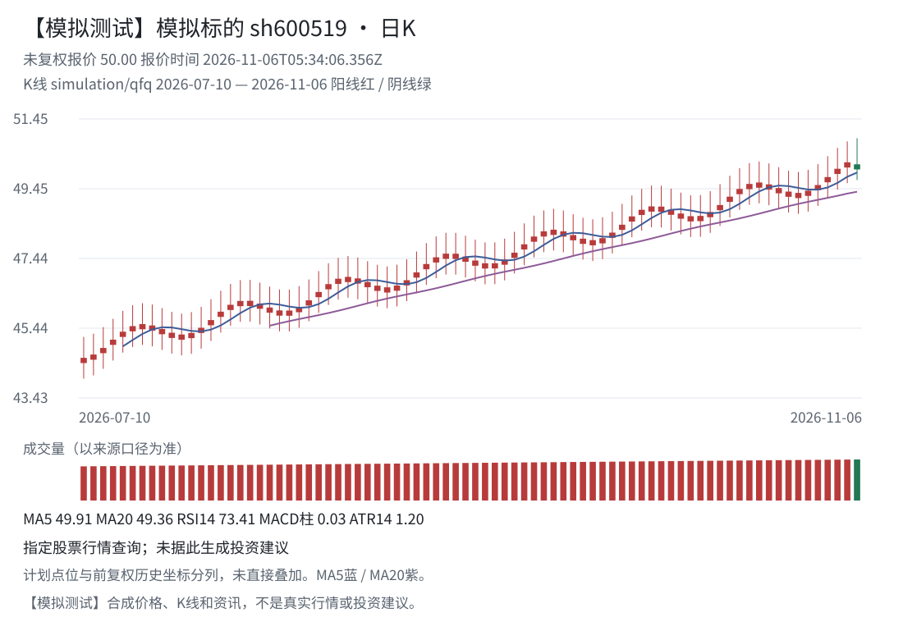

# A股投研 · DeepSeek Harness 版

这是 `dsh-plugin-ashare-workbench` 的 DeepSeek Harness 入口。Cindy 和 DSH 复用同一份行业范围、研究、五类证据、行业四组、股票三档、配仓风控、计划、模拟账本和报告业务代码；宿主存储、工具注册、图片输出及调度由本目录适配。

**只提供研究建议，不自动交易，不承诺收益。** 研究流程完成不代表所有股票已分档；证据不足独立保留，不强行归为“不推荐”。

## 安装

已测试环境：Linux、Node.js `22.22.1`、DSH `0.2.1-rc.5`、sharp `0.35.5`。安装应使用当前包 `engines.dsh` 允许的版本；不要用版本豁免掩盖接口缺失。

本地已打包文件：

```sh
dsh plugin --profile web add /绝对路径/dsh-plugin-ashare-workbench-0.17.3.tgz
```

在 npm **实际发布之后**，才可使用：

```sh
dsh plugin --profile web add dsh-plugin-ashare-workbench@0.17.3
```

`dsh plugin` 将包操作交给指定 profile 的包管理器，`add` 才是安装参数；不是 `plugin install` 或 `plugins install`。包的 `dsh.bundle` 加载 `dsh/cordis.patch.yml`，入口为根包导出的 `dsh-plugin-ashare-workbench/dsh`。该入口要求真实 `tools` 和 `profileContext` 服务，不能当普通浏览器脚本加载。

本轮没有修改正在使用的 `web` profile、安装插件、重启 DSH 或发起模型请求。是否热重载取决于当前 DSH 的 HMR 配置；不要自动重启正在运行的任务。

## 数据与账户

缺省数据根是当前 DSH Home 的 `storages/ashare-workbench/<profile>`。`dataDir` 可通过插件原生配置设置为一个新的专用绝对目录：非空且没有本插件标记的目录拒绝接管，符号链接与越界路径拒绝访问；同时只允许一个写入实例。它不读取 Cindy Library、Cindy 的账户配置或微信凭据。

工具统一带 `ashare_` 前缀。`ashare_configure` 保存 DSH 独立账户的可用资金、实际持仓、风险参数与倾向行业：

- `industrySelectionMode: "hot120"`：按完整目录中的本次成交额快照取前120，少于120时保留真实数量；缺少成交额或目录不完整时拒绝声称已取得前120。
- `industrySelectionMode: "manual"`：`industryIds` 为用户选择的非空行业代码集合；通过 `ashare_get_research(view:"industry_catalog")` 搜索、分页读取，不手写猜测行业 ID。

热度只是范围筛选，不是价值分档；不同层级行业可能重叠。DSH 账户目前通过原生工具/对话配置，未另实现 Cindy 工作台的同款账户面板。

`mode: "live"` 与 `mode: "simulation"` 的配置、批次、计划和报告分别持久化。模拟报价、K线、资讯与资金不会写入 live。`ashare_plan_control` 的历史清理预览/执行复用同一契约，必须由主代理按用户明确要求操作；不会在插件启动或安装时自动清理。导出文件只写当前工具调用者 Session 的工作目录，未提供工作目录时写到插件自己的 exports 根。

## 完整研究流程

1. `ashare_get_state` → `ashare_get_research(view:"industry_catalog")` → `ashare_configure` 明确资金、风险和范围。
2. `ashare_begin_research`、`ashare_collect_batch` 按已冻结范围采集，稳定 `requestKey` 同次重试不变。
3. 使用股票资料、官方原文与监管回执，完成真实独立双人互核；元数据、零条查询、缓存存在均不等于读过正文或无风险。
4. 多行业通过 `ashare_get_research(view:"delegation")` 取得任务，主代理实际调用当前 DSH 的子代理工具，每行业只读、最多3并行，其余排队。子代理不能配置账户、采集、保存判断、定稿、操纵调度或消息回执。
5. 主代理持本行业 token 与实际 workerId 串行保存 `ashare_record_judgment`；证据不足按原生不足终态保存。增量协议下局部变化只重审关联行业，旧 token 不得换名字复用。
6. 主代理最终核对最新行情、资讯、五类证据及全部行业，调用 `ashare_finalize_research`。正仓位必须通过原有报价、日K、仓位、止损预算和五类正文门禁；等待/现金方案合法。
7. 正式计划产生调度和报告待办，再分别执行、读回、记录实际外部 ID。不要把产生待办当成已经执行。

`ashare_export_report(format:"kline_png")` 使用共同图表数据模型、真实数据日期及来源，由 DSH 的 SVG→PNG renderer 导出1100×780图片；不需要浏览器 `document/canvas`。模拟图醒目标识，不当真实行情展示。PNG与Markdown可直接交付，但导出不等于微信发送。

下面为本适配器真实导出的**合成行情测试图**，不是600519真实走势：



## DSH 原生调度与微信差异

`ashare_host_action(operation:"capabilities")` 返回当前 scope 实际启用的能力，未注入 Schedule 时不假装可用。

- `apply_schedule`：仅显式执行已认领范围内的 live `create/update` 待办，绑定实际主代理的 DSH Session；调用真实 `ctx.schedule.create/update`，通过 `list` 读回后才记录返回的调度 ID。
- 每个外部尝试先持久化完整预期（Session/动作ID、名称、完整指令与标识、规范周期及SHA256）。结果未知时仅 `reconcile_schedule` 从原生列表核对全部字段且要求唯一匹配；已有外部ID时必须同ID，不能改绑另一个看似匹配的任务。外部改动名称、指令、周期、时区或Session时不记成功；缺少完整调用前日志也不自动通过。原生更新前还须匹配最近一次已确认预期，防止覆盖被外部改作他用的同ID任务。
- **当前 DSH Schedule 没有原生暂停接口**：`pause` 待办会保留并明确返回不支持；不删除后假称原ID仍可恢复。
- **没有 Cindy 的原生 pre-run-hook/expireAt 同等接口**：扫描调度可以使用工作日 cron；交易所休市和计划过期由提示词先检查。这会唤起模型，不能声称实现了零模型节假日跳过。仍需真正的原生计时触发端到端验收。
- **本版没有连接 DSH 独立微信通道**：不读取或迁移 Cindy iLink/ClawBot 授权。报告保持 `pending`；接入用户明确连接的 DSH 消息能力/MCP后，由主代理认领、发送并保存真实 `messageId`。未返回消息ID不能记成功。
- 模拟研究不通过此宿主工具创建真实调度；子代理不能执行宿主待办。

## 开发与测试

```sh
node --test tests/dsh*.test.cjs
node dsh/native-smoke.mjs
```

专属集成测试涵盖真实文件/SQLite持久化、重启一致、hot120/手动范围、live/simulation隔离、模拟完整研究/三档/配仓/计划/双调度待办、实际PNG/Markdown导出、取消与工作进程退出。调度API契约测试使用明确命名的离线 fixture，并不冒充已在用户 DSH 上创建、触发了调度。

`native-smoke.mjs` 发现已装 DSH 的公开包位置，把源码和SDK依赖放入临时独立包，使用真实 Cordis、`ToolRuntime`、schema验证器注册全部工具并执行只读/模拟调用；保留真实根package.json的模块类型及公开元数据（仅设private:true），提供临时 profile 事实和无模型 prompt 容器，完全不读取用户 profile 或凭据。它验证SDK注册、调用、参数校验及实际模拟PNG导出，不代表完整生产 Web profile 或原生计时/微信端到端验收。

## 市场发布

官方支持自托管插件索引；本机社区 `dsh-plugin` 市场另有审核机制。公开源码、GitHub `dsh-plugin` topic、根 `package.json`、README、许可证及兼容说明是社区收录材料。要出现在 DSH 内的社区插件中心，必须实际发布 npm 包；仅有GitHub源码或tgz不能称已上架。

当前 npm 登录/发布不可用时保留可安装tgz和源码，等账号恢复后再发布并提交市场；不绕过账号限制、不借用其他应用凭据。

参考：[官方打包安装](https://github.com/deepseek-ai/deepseek-harness/blob/master/docs/user/develop/basic/publish.md)、[官方插件索引](https://github.com/deepseek-ai/deepseek-harness/blob/master/docs/user/guide/plugin-market.md)、[社区收录要求](https://dsh-plugin.org/zh/submit)。
